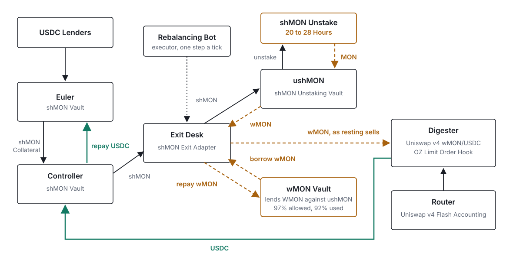

# 1. Overview

## monad.structures.gg

monad.structures.gg is a yield vault on Monad.
* shMON is deposited as collateral
* the vault borrows a stablecoin against it, and buys more shMON with the loan
* The vault holds a Hyperliquid perpetual short so the vault's exposure to the asset stays at a fixed "resting delta" of either one or zero.

The vault earns from the levered yield on shMON, plus the funding paid to shorts, less the borrow cost.

On Monad the asset is **shMON**, Fastlane's liquid staking token for MON. Two vaults are live, one per resting delta:

| Vault | Resting delta | What a holder owns |
|---|---|---|
| `shmon-neverland-usdc-hl` | 1 (delta one) | shMON exposure plus the carry |
| `shmon-neverland-usdc-hl-d0` | 0 (delta neutral) | the carry only, in dollars |

Both borrow USDC or USDT0 from two lenders: Neverland (an Aave v3 fork on Monad) and an Euler cluster the team deployed
itself.[^lenders]

## Increasing shMON to USDC Capacity

The current onchain route from shMON to USDC (or USDT) is limited to ~$25k at 0.3% to 0.6%, and above that the slippage is much worse. A serious vault is not able to safely unwind or serve withdrawals, without holding an 18 to 21 hour duration risk for unstaking shMON.

There are three ways out of shMON:[^shmonad]

- **The slow unstake.** Free, and it takes about a day: 19.6 hours typically, 18.2 to 21.3 hours for 8 in 10 requests.
- **shMON/WMON on Curve** holds 3.9 million WMON (~$54k) on 2026-11-19, and there are no meaningful shMON/USDC pairs:
  - $22.8k at 0.28% under the rate
  - $45.7k at 1.06% under the rate
- **Fastlane Instant Redemption** is an exhaustible / replenishable fund, holding 3.36 million MON (~$48.5k) on 2026-11-18:
  - $12.0k at 0.55% fee
  - $23.9k at 0.62% fee
  - $47.8k at 0.74% fee

Without an increase in capacity, depositors are exposed to liquidation risk and slippage which eats into yield, making this an obstacle toward scaling both shMON as an asset, as well as any leverage product.

## What the exit desk does

The Exit Desk is an adapter, which is owned by the shMON vault. It enables resting limit orders of wMON through a Univ4
Hook.

ushMON represents a tokenized claim on the 18 to 21 hour process of unstaking shMON. wMON lenders provide a one day line of credit backed by the MON staking contracts, and receive a high lending APR whenever ushMON is active.

The exit desk enables a metabolic rate of $6k to $15k of WMON an hour,[^rate] executed through Maker Orders, one tick above the market in the desk's own Uniswap v4 pool, and a keeper fills them from flow on other WMON/USDC venues. Capacity in this is limited to onchain demand, as well as depth of wMON lending -- rather than slippage in current shMON/wMON pools, or instant redemption limits.

The Exit Desk will also become more efficient by integrating with Kyber.

## Functionality

Each vault has an **exit desk**, which minimizes slippage, and enables a steady metabolic rate for derisking, and withdrawals:[^desk]

1. It parks the shMON in the vault's **unstaking shMON vault (ushMON)** on the Euler cluster and sends it into the
   unstake. The parked shMON is Euler collateral.
2. It borrows **WMON** (wrapped MON) against it from the cluster's WMON vault, at up to 93% of value.
3. It sells that WMON for USDC through the **digester**, a Uniswap v4 pool where the desk rests small limit
   orders one tick off the market and a keeper fills them from other pools' flow.
4. A day later the unstake pays MON back into ushMON as WMON, and the desk repays the WMON loan with it in one Euler
   batch. The leaver has been paid in stablecoin at the fee-free rate, less a 0.3% exit fee that stays with the holders
   who remain.

## Eulerswap Integration:

The same desk owns an **EulerSwap pool**, a Uniswap v4 hook AMM whose liquidity is an Euler account instead of a token
balance. When the Desks are not utilizing ushMON to support their vaults, the pool buys shMON from anyone at 0.3% under the live rate for shMON.

The v4 hook means that this pool can be accessible by any router on Monad, which means that if wMON supply can be attracted into the lender pool, ushMON will provide the deepest shMON/wMON liquidity, while the lenders are paid for the ~1 day duration risk. 

The 0.3% fee from these sales is absorbed as an additional yield source for the shMON vaults. The pool competes for the flow that now pays Fastlane's instant exit fee, 3.5 to 9.4 million MON a month since launch.[^flow]

You can read more about ushMON here.[04-ushmon.md](04-ushmon.md).

[^lenders]: `alphastructures/CLAUDE.md:32`, `docs/Alpha_Structures_Architecture.md:10-11,29`.
[^shmonad]: `evidence/data/unstake-timing-30d.md` (119 requests, read 2026-11-05); `evidence/data/shmonad-30d.md` (720 hourly reads to 2026-11-05); instant exit quotes and live fee `getCurrentUnstakeFeeRateRay() == 0.4949%` at block 123385653, Curve quotes at block 123482098, in `evidence/live-reads.md`.
[^desk]: `alphastructures/docs/Alpha_Structures_Digester.md:3-7,25,38-39`; `docs/shmon-exit-desk-plan.md:36-43`; exit fee `contracts/core/WithdrawalHandler.sol:34-35,283`.
[^flow]: `evidence/data/instant-history.md`, monthly table (instant exits paid out 2025-12 to 2026-10).
[^rate]: `evidence/data/rate-30d.md`: 30 days of real WMON/USDC swaps replayed with the keeper's fill rule; a $200k or $500k inventory sells in 13.5 to 35.5 hours if the keeper wins 25% of each trigger, 35.5 to 73.9 hours at 10%.
