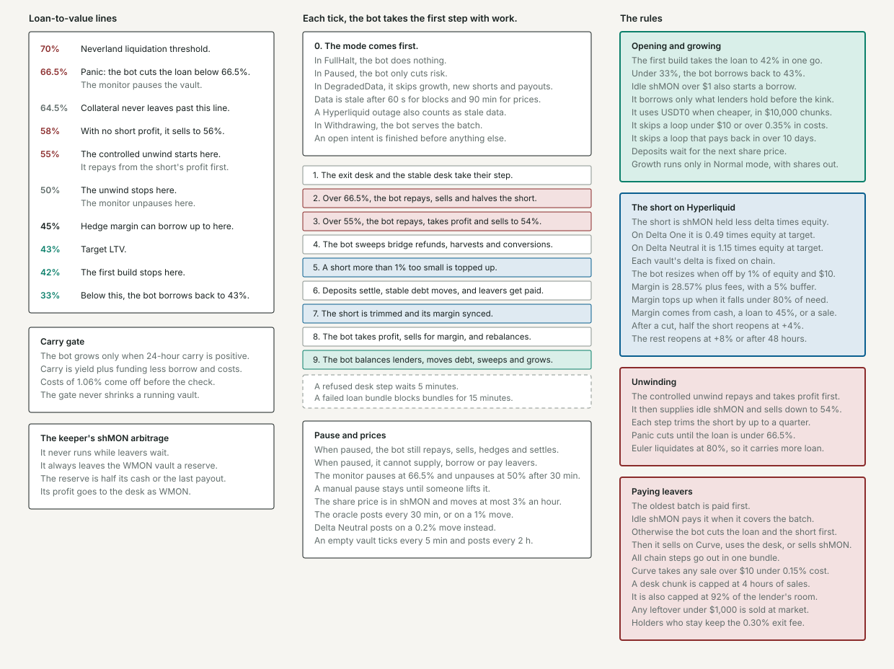
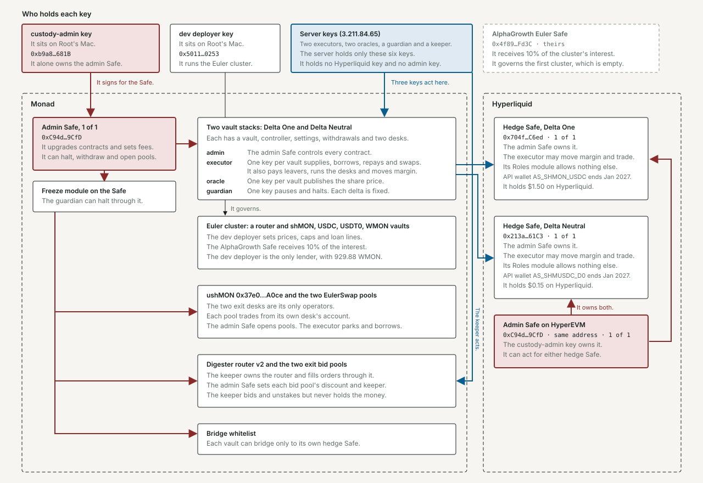

# 2. Alpha Structures: the vault system

Repo: [alphagrowth/alphastructures](https://github.com/alphagrowth/alphastructures) at `be23722`. The system's own
guide is `AGENTS.md`; the design docs are under `docs/`.

## The strategy in one loop

"Each vault supplies its collateral asset to a lending market, borrows a stablecoin against it, buys more collateral
with the loan, and holds a Hyperliquid perp short that sets the vault's exposure to a fixed resting delta (0 or 1; …)."
(`docs/Alpha_Structures_Architecture.md:5`.) The loop repeats until the vault's loan-to-value reaches its target; there
is no fixed loop count (`Architecture.md:324`). Net profit is funding received on the short less the borrow cost
(`Architecture.md:314-324`).

- **Book shape.** The short equals the collateral exposure less `d` times equity, so the book rests at `d` dollars of
  delta per dollar of equity (`CLAUDE.md:61`). `d` is 1 on the `-hl` vaults and 0 on the `-d0` vaults, held on chain in
  `StrategyControllerSettings`. Since 2026-11-18 Settings 1.15 has no setter, so each vault's delta is fixed for good.
- **Target LTV.** The lowest of the liquidation threshold times one minus the worst recorded 24-hour fall, 95% of the
  threshold, and 2 points under the 45% line (`services/rebalancingBot/src/policy/worstFallPolicy.ts`). The last one binds, so
  the target is 43%. The shMON
  vaults use a 34.48% worst fall measured on Binance futures MONUSDT (production configs, `runtime.worstFall`).
- **Lines.** Target 43%, hedge-margin loan cap 45%, controlled unwind at 55%, panic unwind at 66.5% LTV (`risk` block of
  each production config). The full set is under [The bot's rules](#the-bots-rules).
- **Hedge.** Hyperliquid, margin ratio 2857 bps (3.5x) on the shMON vaults; no trading key exists, every order is a
  CoreWriter call from a Safe through its Roles module (`docs/Alpha_Structures_Threat_Model.md:166`).

## The bot's rules

Every number is the live config's, a code constant, or read on chain on 2026-11-18. The bot takes one step per 30-second
tick, and the target is 43% because the line two points under 45% binds before the worst-day term does.

| Rule | Number | Fires | Source |
|---|---|---|---|
| Liquidation | 70% today | the whole vault is sized against the stricter lender's line, Neverland's 70%; the split then puts more of the loan on Euler (80%) until both loans sit the same share of the way to their own line; a read under 50% is replaced by 50% with an alert | `lenders.ts`, `observe.ts` |
| Target LTV | 43% | the loan the bot keeps | `policy/worstFallPolicy.ts` |
| First build | 42% | whole book in one go before the first short | `planner/growth.ts` |
| Re-lever | below 33%, or idle shMON over $1 | borrow back to 43% | `planner/growth.ts` |
| Margin loan cap | 45% | borrow for hedge margin up to here, then sell shMON | `planner/growth.ts` |
| Profit band | repay over 55%, sell over 58% down to 56% | above 55%, repays the loan from the short's profit that came home, toward 43%; with no profit to take and above 58%, sells shMON down to 56%; acts only when the controlled unwind, which runs earlier in the cycle, finds nothing to do | `planner.ts` |
| Controlled unwind | 55%, sell to 54%, stop at 50% | repay, profit slice, supply, sell; each step trims the short by the smaller of a quarter or the part above what the remaining shMON needs, so the vault keeps its delta | `planner.ts`, `planner/unwind.ts` |
| Panic | 66.5% | full repay and sale, half the short per tick; monitor pauses | `planner.ts`, monitor `breaker.ts` |
| Short size | (C + idle + desk shMON − d·E) / price | open or trim when off by 1% of equity and $10 or more | `policy/base.ts`, `planner/hedge.ts` |
| Margin | 28.57% + 0.05%, × 1.05; top up under 80% | transfer from idle, loan to 45%, or shMON sale | `planner/growth.ts` |
| Rebound reopen | +4% half, +8% or 48 h all | reopen the short after a pay-down | `planner/unwind.ts` |
| Carry gate | enter at ≥ 0 after 1.06% costs, 24 h averages | allows growth; never stops it | `policy/worstFallPolicy.ts` |
| Cost gate | loop ≥ $10, drag ≤ 0.35%, payback ≤ 10 d | skips an uneconomic loop (not the first build) | `policy/costGate.ts` |
| Lender balance | risk spread 0.5 pt | moves shMON toward the lender further from its liquidation; empties a lender with no debt | `lenders.ts` |
| Paying leavers | oldest batch first | idle shMON pays; else repay, profit buy, trim and margin, profit slice, Curve, desk route, sale, redeem | `planner.ts`, `planner/unwind.ts` |
| Curve first | over $10, average cost ≤ 0.15% | sells leavers' shMON for WMON on Curve before the desk route | `planner/exitDesk.ts` |
| Desk chunk | min(owed, 4 h × 25% taker buys, room × 92%) | park, borrow, sell in the digester | `planner/exitDesk.ts` |
| Leftover | $10 to $1,000 | market swap at home after Curve declines | `planner/exitDesk.ts` |
| Share price limit | 3% an hour, one window | shares are priced in shMON; the contract refuses a bigger move, counted in dollars per share on Delta Neutral | `StrategyControllerSettings.sol`, `risk.sharePriceDeviation` |
| NAV publish | 1% Delta One, 0.2% Delta Neutral, 30 min, 2 h empty | the oracle posts the share price | navOracle `publish.ts` |
| Modes | block 60 s, price 90 min, venue health | DegradedData blocks growth, new shorts, payouts | `state/modeMachine.ts`, `staleness.ts` |
| Breaker | pause 66.5%, unpause 45% after 30 min | the monitor pauses and unpauses | monitor `breaker.ts` |
| Hedge drift warning | 3% of target, $10 or more | the monitor warns; the bot itself moves at 1% | monitor `checkStrategy.ts` |
| Fixed delta | 1 and 0, on chain | Settings 1.15 has no setter; no gear shift can start | `StrategyControllerSettings.sol` |
| Performance fee | 10% of every rise over the last published price | Settings 1.16, live 2026-11-18; a fall charges nothing and moves the mark down | `StrategyControllerSettings.sol` |
| Idle | 5 min tick, NAV 2 h | an empty vault's cadence | `idle.ts` |

## Two lenders

The shMON vaults borrow from Neverland, an Aave v3 fork on Monad, and from the Euler cluster the team deployed
(`CLAUDE.md:32`, `Architecture.md:10-11,29`). Each lender has its own LTV lines scaled to its liquidation threshold.
The bot sizes a borrow by the lender's room before its rate kink: free cash, capped so utilization stays at or under the
kink (`services/rebalancingBot/src/lenders.ts:128-166`). A **stable desk** moves USDC debt to USDT0 when Neverland's USDC
is past its kink (`Architecture.md:10-11`). The cluster is described in
[06-euler-cluster-and-neverland.md](06-euler-cluster-and-neverland.md).

## NAV and the share price

The NAV oracle sums market collateral less debt at every lender, controller balances, the stable desk's net position,
the exit desk's holdings (idle tokens, pending unstake, open orders, and its Euler account: parked shMON less the WMON
loan), venue equity and venue-wallet balances, and publishes an asset-denominated share price with `setSharePrice`
(`docs/Alpha_Structures_System_Overview.md:127-136`). "The published share price is measured, never forecast"
(`System_Overview.md:138`). NAV posts every 30 minutes, or every 2 hours on an empty vault (`CLAUDE.md`, idle vaults).

## Withdrawals

Every redemption request joins a batch. A batch settles at the lower of the request-time and fulfilment-time share
price and pays pro rata by shares; shares redeem no sooner than one hour after the receiver's last deposit
(`System_Overview.md:77`). Every production config sets the batch window to 300 seconds plus the time the bot needs to
unwind (`System_Overview.md:140`). Since WithdrawalHandler v1.9.0 a batch settles 0.3% under its price-sized amount and
the difference stays with the holders who remain (`contracts/core/WithdrawalHandler.sol:34-35`, deduction at line 283,
`setExitFeeBps` at 523-527, set to 30 bps by the admin Safe in `custody/release-mm-143.ts:41,137`).

## The two production vaults

Configs: `deploy/configs/production/shmon-neverland-usdc-hl.json` and `shmon-neverland-usdc-hl-d0.json`. Manifests:
`deploy/deployments/production/*.json`. Both run on Monad (chain 143) with the same eight adapters in their configs: `neverland-market`,
`euler-market`, `shmonad-stake`, `across-bridge`, `uniswap-swap`, `curve-swap`, `stable-desk`, `shmonad-exit` (the
manifests also carry a `kyberswap` adapter proxy).

| Contract | shmon-neverland-usdc-hl (delta one) | shmon-neverland-usdc-hl-d0 (delta neutral) |
|---|---|---|
| Deployed | 2026-10-08, git 9040364 | 2026-10-31, git 17e8b65 |
| Vault (ERC-4626 shares) | [0xeEe3dAb9fc5d3833aE219F87A1Fbb68F3d4431D3](https://monadscan.com/address/0xeEe3dAb9fc5d3833aE219F87A1Fbb68F3d4431D3) | [0x187bEF1d746350B22e0Ab1FAfA2A96a6F4aF272C](https://monadscan.com/address/0x187bEF1d746350B22e0Ab1FAfA2A96a6F4aF272C) |
| StrategyController | 0xc27A2eA394c1499FA6261bd12f38D813C2DecB51 | 0x13B7aF96a7f1F7E0A4E228CcC0e437389492F5Ae |
| StrategyControllerSettings | 0xdE30DFdC5107D52c1Dec101db4afDC6a7372adEC | 0xC62D354c3B8fbBEEA9Bee2D35Da38e015770F85a |
| WithdrawalHandler | 0xFb78583f6D8A9F6c2cCae6111e2817AC9824162a | 0x4B821aFd90eF4F5a35Dec5e4AeeA7C00c7d90Af2 |
| Exit desk (`shmonad-exit` proxy) | [0x02Df7fb3b4535361EE10C391e3bDDAEe9001c770](https://monadscan.com/address/0x02Df7fb3b4535361EE10C391e3bDDAEe9001c770) | [0xF460C4C68704Da32Ba3cefC2feEcaA3C3f3d6CdE](https://monadscan.com/address/0xF460C4C68704Da32Ba3cefC2feEcaA3C3f3d6CdE) |
| Exit desk implementation | 0xDF9515a5d2f68B12a4fAFc44e518B13751A1c3B2 (v1.8.0, upgraded 2026-11-17, read on chain; v1.7.0 was 0xBE243F5e4215720080929eeCfe77047D2Fd2a410, v1.6.0 0x623E3EC3E218FcA770eF4bb5Ce5c1399F86Ba467) | same |
| Neverland adapter | 0x56251dbe…61C5 | 0xF79E5fA8…DC7D |
| Euler adapter | 0xa4a912E0…384d | 0x071b7277…5ABB |
| Stable desk | 0xc19aa853…599a | 0x2dCDEB8B…28f1 |
| Executor key | 0xC95F60fd…71D3 | 0xF3206EfC…3669 |

Full addresses for the abbreviated rows are in the manifests. Both vaults are empty at the time of writing
(`evidence/live-reads.md`).

## Roles and permissions

One key, the custody-admin keystore on Root's Mac, stands behind every Safe. The server holds the keys that run the
vaults each tick, and those keys can move money only inside the strategies and the hedges.

| Key or Safe | Address | Where | What it can do |
|---|---|---|---|
| custody-admin key | `0xb9a86575182c0F0F07e8b7404612c8207c87681B` | Root's Mac | Sole owner of the admin Safe on Monad and on HyperEVM. |
| Admin Safe | `0xC94dd8e928D681bd85BeB94a8729709d189cCF9D` | Monad and HyperEVM, 1 of 1 | Upgrade every contract, change settings and the 10% performance fee, halt, emergency withdraw, open or retire pools, own both hedge Safes. |
| Freeze module | `0x6c3A2bE9c75b5ed1b8144EB970Bcd35A52F93D4d` | on the admin Safe | Lets the guardian key halt a vault without the admin key. |
| Executor, Delta One | `0xC95F60fdE77ECEBf9DED1228A939ac8eDB2671D3` | server env | Supply, borrow, repay, swap, bridge, pay leavers, run the exit and stable desks, move hedge margin and trade through the Roles module. |
| Executor, Delta Neutral | `0xF3206EfC847386E66043459832eDb74998C63669` | server env | Same, for its own vault. |
| Oracle, Delta One | `0x77d550f9C11AAFC69Cb7651d7B2E405BE43Eb0B9` | server env | Publishes the share price, within the deviation budget. |
| Oracle, Delta Neutral | `0x2ECF679c2DF38a758F365f1EEc7CD090567FD5e7` | server env | Same, for its own vault. |
| Guardian | `0x868736358fA307d70b359BcaB2e92e6A7ED0734C` | server env | Pause and unpause both vaults, halt through the freeze module, top up gas. |
| Digester keeper | `0xEE51d642304f8F0b272Fc79cf851CE76ee24c3A7` | server env | Owns digester router v2 `0xE1fe1Ea6677Ea56eEFD381045AAcf86D541C3776` (fills orders, gains go to the vault; runs the shMON arbitrage, gains go to the desk); keeper of the two exit bid pools. |
| dev deployer | `0x501107fe590c8F9b81c00b81867fD19e0d9c0253` | Root's Mac | Governs the Euler cluster: prices, caps, loan lines. Lent the 929.88 WMON float. |
| AlphaGrowth Euler Safe | `0x4f894Bfc9481110278C356adE1473eBe2127Fd3C` | theirs | Receives 10% of the cluster's interest; governs the empty first cluster. |
| Hedge Safe, Delta One | `0x704f20644035b5fA822cC920a25C99F97BF7C6ed` | HyperEVM / HyperCore, 1 of 1 | The vault's Hyperliquid account. Owner: the admin Safe. Roles module `0x0253…0Cba` lets the executor move margin and trade. |
| Hedge Safe, Delta Neutral | `0x213a4C29c42Bb956c34064750b689baB313561C3` | HyperEVM / HyperCore, 1 of 1 | Same. Roles module `0x0Aa4…9028`. |
| API wallets | `0x1dE4…8435`, `0xeb12…142C` | Root's Mac env file, approved on Hyperliquid to Jan 2027 | Trading only, on the hedge accounts. Not on the server; the bot signs through the Roles module instead. |
| ushMON operators | `0x37e07473F1F62CB071Db57440e242b320614A0ce`, operated by the two exit desks | contracts | The only addresses that can get ushMON shares or start an unstake; each desk's unstakes and WMON stay on its own ledger. |

## Where it runs

One server, `3.211.84.65`, serving `monad.structures.gg`, runs 12 containers (`docker ps` 2026-11-18 18:38Z,
`evidence/live-reads.md`): one bot per shMON vault, one NAV oracle (`oracle-hyperliquid`), `monitor`, `funding-feed`,
`api`, `www-user`, `caddy`, `research-refresh`, `rpc-meter`, `monad-digester` and `mongodb`. The six "server env" keys
above were derived from the running containers' environment on that read, and each matches its address. Production is built on the server from
`/opt/alphastructures/src`, never from a developer machine (`CLAUDE.md`).
