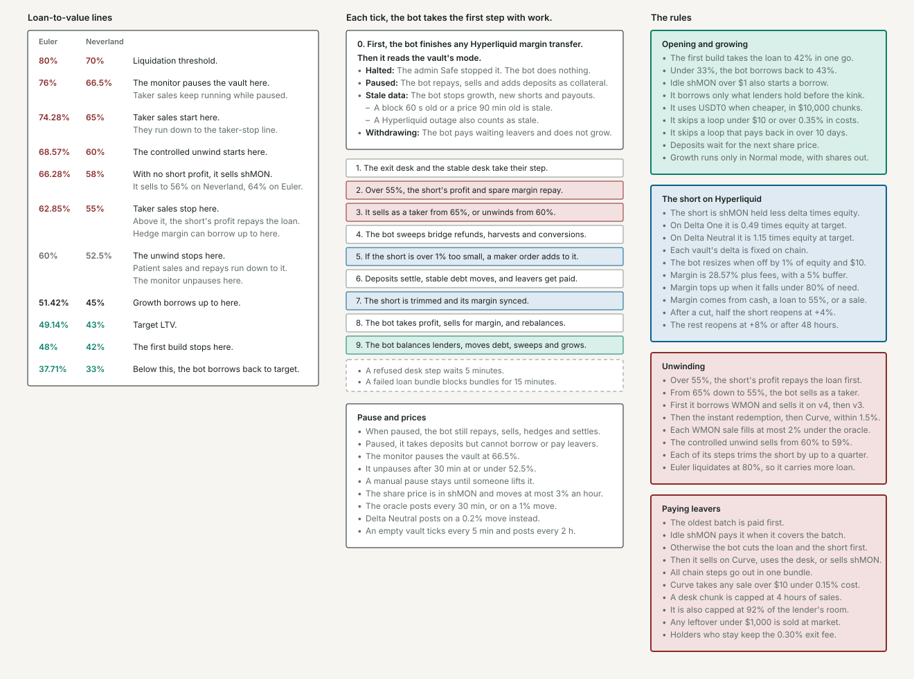
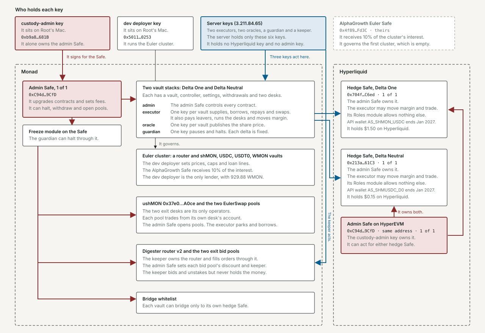

# 2. Operations:

Alpha Structures is the vault system behind monad.structures.gg.[^repo]

## Strategy

Each vault runs one loop:[^arch]
* It supplies shMON to a lender and borrows a stablecoin against it.
* It buys more shMON with the loan, and repeats until the loan reaches 43% of the collateral.
* It holds a Hyperliquid short sized so the vault's exposure stays at its resting delta, 1 or 0.

The vault earns shMON's staking yield on the levered collateral, plus the funding paid to the short, less the borrow cost.

| Setting | Value |
|---|---|
| Target loan-to-value (LTV) | 43%, two points under the 45% margin loan cap[^target] |
| Worst 24-hour fall used | 34.48%, Binance MONUSDT futures |
| Hedge margin | 28.57% of the short (3.5x) |
| Resting delta | 1 on Delta One, 0 on Delta Neutral, fixed on chain with no setter |
| Deposit cap | 84 million shMON per vault, about $2M |
| Performance fee | 10% of every rise over the last published price; a fall charges nothing |

Every hedge order is a CoreWriter call from a Safe to Hyperliquid, through its Roles module.[^hedge]

## Bot:

The bot takes one step every 30 seconds. Each row is one rule, read from the two production configs, the bot's code and the chain.

| Rule | Number | Fires | Source |
|---|---|---|---|
| Liquidation | each lender's own line | The bot splits the loan so both lenders sit the same share of the way to their own line. A line read under 50% counts as 50% and alerts. | `lenders.ts`, `observe.ts` |
| First build | 42% | Builds the whole book in one go before the first short. | `planner/growth.ts` |
| Re-lever | below 33%, or idle shMON over $1 | Borrows back to 43%. | `planner/growth.ts` |
| Margin loan cap | 45% | Borrows for hedge margin up to here, then sells shMON. | `planner/growth.ts` |
| The short's money | over 55% | Trims the short to its target, brings spare margin and profit home, and repays. | `planner/panic.ts` |
| Taker sales | from 65% down to 55% | Leftover WMON sells first. Then the bot borrows WMON against shMON and sells it on the v4 pool, then Uniswap v3, in one transaction. Then the instant redemption, then Curve. Each shMON swap costs at most 1.5%, and each WMON sale fills at most 2% under the oracle. The short is never half-closed. | `planner/panic.ts` |
| Controlled unwind | 60%, sells to 59%, stops at 52.5% | Repays, supplies idle shMON, then sells. Each step trims the short by up to a quarter, so the vault keeps its delta. | `planner.ts`, `planner/unwind.ts` |
| Profit band | over 58%, sells to 56% | Sells shMON when there is no profit to take and the unwind found nothing to do. | `planner.ts` |
| Breaker | pause at 66.5%, unpause 30 min at 52.5% | The monitor pauses the vault. Taker sales keep running, and deposits still come in as collateral with no borrowing. shMON owed to leavers stays in the vault. | monitor `checkStrategy.ts` |
| Short size | (C + idle + desk shMON − d·E) / price | Opens or trims when off by 1% of equity and $10 or more. An open rests as a maker order one tick over mid and moves with mid each tick. A trim sells at market. | `policy/base.ts`, `planner/hedge.ts`, `actions/venue.ts` |
| Margin | 28.57% + 0.05%, × 1.05; top up under 80% | Tops up from idle cash, a loan to 45%, or a shMON sale. | `planner/growth.ts` |
| Rebound reopen | +4% half, +8% or 48 h all | Reopens the short after a pay-down. | `planner/unwind.ts` |
| Cost gate | loop ≥ $10, drag ≤ 0.35%, payback ≤ 10 d | Skips an uneconomic loop, except the first build. | `policy/costGate.ts` |
| Lender balance | risk spread 0.5 pt | Moves shMON toward the lender further from its liquidation. | `lenders.ts` |
| Paying leavers | oldest batch first | Idle shMON pays first. Otherwise the bot repays and trims the short, then sells on Curve, through the desk, or on the market, in one bundle. | `planner.ts`, `planner/unwind.ts` |
| Curve first | over $10, average cost ≤ 0.15% | Sells leavers' shMON for WMON on Curve before the desk route. | `planner/exitDesk.ts` |
| Desk chunk | min(owed, 4 h × 25% taker buys, room × 92%) | Parks, borrows and sells in the digester. | `planner/exitDesk.ts` |
| Leftover | $10 to $1,000 | Swaps at market after Curve declines. | `planner/exitDesk.ts` |
| Share price limit | 3% an hour | The contract refuses a bigger move in the share price. | `StrategyControllerSettings.sol` |
| Modes | block 60 s, price 90 min, venue health | Stale data blocks growth, new shorts and payouts. | `state/modeMachine.ts`, `staleness.ts` |
| Hedge drift warning | 3% of target, $10 or more | The monitor warns. The bot itself moves at 1%. | monitor `checkStrategy.ts` |
| Idle | 5 min tick | An empty vault's cadence. | `idle.ts` |

## Neverland & Euler:

Both vaults borrow USDC or USDT0 from two lenders:[^lenders]
* **Neverland**, an Aave v3 fork on Monad: shMON borrows at 65% and liquidates at 70%.
* **The team's Euler cluster**: shMON borrows at 79% and liquidates at 80%.

The bot borrows only the room left before each lender's rate kink.[^kink] A **stable desk** moves USDC debt to USDT0 when
Neverland's USDC is past its kink. The cluster is in [06-euler-cluster-and-neverland.md](06-euler-cluster-and-neverland.md).

## NAV Oracle:

The NAV oracle calculates share price onchain.[^nav]
* It accounts for collateral, debt, vault controller balances, exit desks, and the Hyperliquid account.
* It posts every 30 minutes, on a 1% move (0.2% on Delta Neutral), or every 2 hours on an empty vault.

## Withdrawals

A redemption request joins a batch that settles about 5 minutes later, plus the time the bot needs to unwind.[^batch]
* A batch pays at the lower of the share price when asked and when paid.
* Shares can redeem one hour after the holder's last deposit.
* The payout is 0.3% under the share price, and that 0.3% stays with the holders who remain. Both vaults read 30 bps on chain.

## The two production vaults

Both run on Monad (chain 143) with the same eight adapters.[^configs] Both are empty: zero shares and zero assets at block 123,484,165.

| Contract | shmon-neverland-usdc-hl (delta one) | shmon-neverland-usdc-hl-d0 (delta neutral) |
|---|---|---|
| Deployed | 2026-10-08, git 9040364 | 2026-10-31, git 17e8b65 |
| Vault (ERC-4626 shares) | [0xeEe3dAb9fc5d3833aE219F87A1Fbb68F3d4431D3](https://monadscan.com/address/0xeEe3dAb9fc5d3833aE219F87A1Fbb68F3d4431D3) | [0x187bEF1d746350B22e0Ab1FAfA2A96a6F4aF272C](https://monadscan.com/address/0x187bEF1d746350B22e0Ab1FAfA2A96a6F4aF272C) |
| StrategyController | 0xc27A2eA394c1499FA6261bd12f38D813C2DecB51 | 0x13B7aF96a7f1F7E0A4E228CcC0e437389492F5Ae |
| StrategyControllerSettings | 0xdE30DFdC5107D52c1Dec101db4afDC6a7372adEC | 0xC62D354c3B8fbBEEA9Bee2D35Da38e015770F85a |
| WithdrawalHandler | 0xFb78583f6D8A9F6c2cCae6111e2817AC9824162a | 0x4B821aFd90eF4F5a35Dec5e4AeeA7C00c7d90Af2 |
| Exit desk (`shmonad-exit` proxy) | [0x02Df7fb3b4535361EE10C391e3bDDAEe9001c770](https://monadscan.com/address/0x02Df7fb3b4535361EE10C391e3bDDAEe9001c770) | [0xF460C4C68704Da32Ba3cefC2feEcaA3C3f3d6CdE](https://monadscan.com/address/0xF460C4C68704Da32Ba3cefC2feEcaA3C3f3d6CdE) |
| Exit desk implementation | 0x74eCd223208D812098487D4090d964005370BDc7 (v1.10.0, upgraded 2026-11-19, read on chain) | same |
| Neverland adapter | 0x56251dbe…61C5 | 0xF79E5fA8…DC7D |
| Euler adapter | 0xa4a912E0…384d | 0x071b7277…5ABB |
| Stable desk | 0xc19aa853…599a | 0x2dCDEB8B…28f1 |
| Executor key | 0xC95F60fd…71D3 | 0xF3206EfC…3669 |

Full addresses for the abbreviated rows are in the manifests.

## Roles and permissions

One key, the custody-admin keystore on Root's Mac, is the sole owner of every Safe. The server's keys can move money only
inside the strategies and the hedges.

| Key or Safe | Address | Where | What it can do |
|---|---|---|---|
| custody-admin key | `0xb9a86575182c0F0F07e8b7404612c8207c87681B` | Root's Mac | Sole owner of the admin Safe on Monad and on HyperEVM. |
| Admin Safe | `0xC94dd8e928D681bd85BeB94a8729709d189cCF9D` | Monad and HyperEVM, 1 of 1 | Upgrade every contract, change settings and the 10% performance fee, halt, emergency withdraw, open or retire pools, own both hedge Safes. |
| Freeze module | `0x6c3A2bE9c75b5ed1b8144EB970Bcd35A52F93D4d` | on the admin Safe | Lets the guardian key halt a vault without the admin key. |
| Executor, Delta One | `0xC95F60fdE77ECEBf9DED1228A939ac8eDB2671D3` | server env | Supply, borrow, repay, swap, bridge, pay leavers, run the exit and stable desks, move hedge margin and trade through the Roles module. |
| Executor, Delta Neutral | `0xF3206EfC847386E66043459832eDb74998C63669` | server env | Same, for its own vault. |
| Oracle, Delta One | `0x77d550f9C11AAFC69Cb7651d7B2E405BE43Eb0B9` | server env | Publishes the share price, within the deviation budget. |
| Oracle, Delta Neutral | `0x2ECF679c2DF38a758F365f1EEc7CD090567FD5e7` | server env | Same, for its own vault. |
| Guardian | `0x868736358fA307d70b359BcaB2e92e6A7ED0734C` | server env | Pause and unpause both vaults, halt through the freeze module, top up gas. |
| Digester keeper | `0xEE51d642304f8F0b272Fc79cf851CE76ee24c3A7` | server env | Owns digester router v2 `0xE1fe1Ea6677Ea56eEFD381045AAcf86D541C3776` (fills orders, gains go to the vault; runs the shMON arbitrage, gains go to the desk); keeper of the two exit bid pools. |
| dev deployer | `0x501107fe590c8F9b81c00b81867fD19e0d9c0253` | Root's Mac | Governs the Euler cluster: prices, caps, loan lines. Lent the 929.88 WMON float. |
| AlphaGrowth Euler Safe | `0x4f894Bfc9481110278C356adE1473eBe2127Fd3C` | theirs | Receives 10% of the cluster's interest; governs the empty first cluster. |
| Hedge Safe, Delta One | `0x704f20644035b5fA822cC920a25C99F97BF7C6ed` | HyperEVM / HyperCore, 1 of 1 | The vault's Hyperliquid account. Owner: the admin Safe. Roles module `0x0253…0Cba` lets the executor move margin and trade. |
| Hedge Safe, Delta Neutral | `0x213a4C29c42Bb956c34064750b689baB313561C3` | HyperEVM / HyperCore, 1 of 1 | Same. Roles module `0x0Aa4…9028`. |
| API wallets | `0x1dE4…8435`, `0xeb12…142C` | Root's Mac env file, approved on Hyperliquid to Jan 2027 | Trading only, on the hedge accounts. Not on the server; the bot signs through the Roles module instead. |
| ushMON v4 operators | the two exit desks, on vault `0xa753E24B0986567EDAd75f784664Ec11336f8C5e` | contracts | The only addresses that can get ushMON shares or start an unstake; each desk's unstakes and WMON stay on its own ledger. |

## Where it runs

One server, `3.211.84.65`, runs 12 containers for monad.structures.gg (`docker ps`, 2026-11-19):
* one bot per vault, the NAV oracle and the monitor
* the digester keeper, the funding feed and the research refresh
* the API, the website, Caddy, the RPC meter and MongoDB

Caddy also serves `admin.structures.gg`, the live revenue page, behind a password ([12-revenue-flows.md](12-revenue-flows.md)).
Production is built on the server from `/opt/alphastructures/src`, never from a developer machine.

[^repo]: [alphagrowth/alphastructures](https://github.com/alphagrowth/alphastructures) at `321a9f7` plus the working tree of 2026-11-19; the system's own guide is `AGENTS.md`, the design docs are under `docs/`.
[^arch]: `docs/Alpha_Structures_Architecture.md:5,314-324`; no fixed loop count (`Architecture.md:324`).
[^target]: `services/rebalancingBot/src/policy/worstFallPolicy.ts`: the lowest of liquidation × (1 − worst fall), 95% of liquidation, and 2 points under 45%; the last binds. Lines from the `risk` and `runtime.worstFall` blocks of both production configs.
[^hedge]: `docs/Alpha_Structures_Threat_Model.md:166`; delta is `getRestingDeltaBps()` in `StrategyControllerSettings` 1.16, which has no setter for it.
[^lenders]: `CLAUDE.md:32`, `Architecture.md:10-11,29`. Lines read on chain 2026-11-18: Neverland `getConfiguration(shMON)` 6500/7000; Euler USDC and USDT0 vaults `LTVFull(shMON vault)` 7900/8000.
[^kink]: `services/rebalancingBot/src/lenders.ts:128-166`.
[^nav]: `docs/Alpha_Structures_System_Overview.md:127-138`; idle cadence in `CLAUDE.md`.
[^batch]: `System_Overview.md:77,140`; `redeemBatchDurationSec` 300 in both configs; exit fee in `contracts/core/WithdrawalHandler.sol:34-35,283`, setter 523-527, set by the admin Safe in `custody/release-mm-143.ts:41,137`; `getExitFeeBps()` 30 on both handlers at block 123,387,135.
[^configs]: `deploy/configs/production/shmon-neverland-usdc-hl.json` and `-d0.json`: `neverland-market`, `euler-market`, `shmonad-stake`, `across-bridge`, `uniswap-swap`, `curve-swap`, `stable-desk`, `shmonad-exit`. Manifests in `deploy/deployments/production/` also carry a `kyberswap` proxy. `totalSupply()` and `totalAssets()` read 0 on both vaults.
