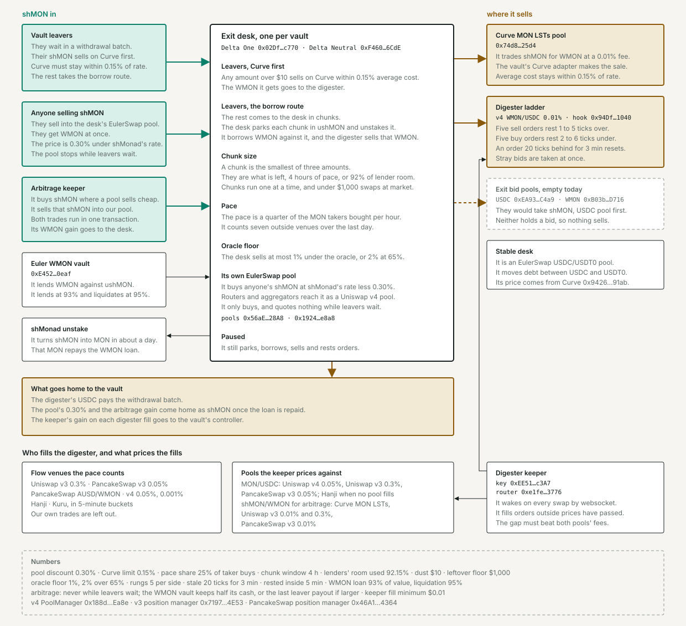

# 3. The exit desk

Contract: `alphastructures/contracts/adapters/venue/ShMonadExitAdapter.sol` at `bd9a894`, a UUPS proxy per vault,
`VERSION = 1_06_00` (line 285), live on both production desks (`evidence/live-reads.md`). Bot: `services/rebalancingBot/src/planner/exitDesk.ts`.

## Why it exists

A leaver's shMON must become stablecoin to repay the vault's loan and pay the leaver. shMonad's instant exit costs
0.41% to 0.73% (30 days of hourly reads, `evidence/data/shmonad-30d.md`); its slow unstake is free but takes about a
day (`evidence/data/unstake-timing-30d.md`); DEX pairs for shMON carry about $2,700 a day of flow
(`evidence/data/rate-30d.md`, 30 days of swaps to 2026-11-05, computed 2026-11-07). The instruction behind the desk (2026-11-03, quoted in `docs/shmon-exit-desk-plan.md:5-8`)
was to build withdrawals on the one-day unstake and to sell with resting orders one tick above the price instead of
taking a market. The withdrawal batch stays five minutes; the desk carries the day (`shmon-exit-desk-plan.md:46-47`).

## What it does

"The vault's slow exit desk on Monad: shMON goes through shMonad's traditional unstake (about a day, no fee), and MON is
sold (or bought) with resting orders one tick step beyond the price" (contract NatSpec, lines 255-258). It is reached
through the controller's existing venue-margin path; funds leave it only to the controller, to shMonad's unstake, or
into a resting order (`shmon-exit-desk-plan.md:36-43`).

**The digester.** "Each vault's exit desk rests small limit orders in our own Uniswap v4 pool, one tick off the market.
Our keeper watches the other Monad pools. When one of them trades past one of our orders by more than both pools' fees,
the keeper fills our order and trades it straight back into that pool, inside a single Uniswap v4 PoolManager unlock.
That needs no capital, and the gain goes to the vault whose order was filled." (`docs/Alpha_Structures_Digester.md:3-7`.)

| Digester piece | Address | Note |
|---|---|---|
| Hook | [0x94Df2bffA788BBd918179f4CCB5A22DbAD7e1040](https://monadscan.com/address/0x94Df2bffA788BBd918179f4CCB5A22DbAD7e1040) | OpenZeppelin `LimitOrderHook` (uniswap-hooks 1.3.0), CREATE2 |
| Pool | poolId `0x3957bb3c02c319231713c06853de9bfc8e7d1aaa276873cd65fc028efc0b1314` | WMON/USDC, fee 100, tick spacing 1, PoolManager `0x188d586Ddcf52439676Ca21A244753fA19F9Ea8e` |
| Router v2 | [0xE1fe1Ea6677Ea56eEFD381045AAcf86D541C3776](https://monadscan.com/address/0xE1fe1Ea6677Ea56eEFD381045AAcf86D541C3776) | owner the keeper key (read on chain 2026-11-18); fills orders and runs the shMON arbitrage. v1 was 0x77eB1B6aab832f3aD11A216Dfcb8613fdA15A088 (`contracts/digester/MonadRouter.sol`) |
| Keeper wallet | 0xEE51d642304f8F0b272Fc79cf851CE76ee24c3A7 | container `digester-keeper`, min gain $0.01 |
| Exit bid pools | 0xEA93Cb7Af4bcdAfF8312BEe55dF369970070C4a9 (USDC), 0xB03b966811eBd2E481a77d2ce118f8fA2c5fD716 (WMON) | `contracts/exit-pool/ExitBidPool.sol`, bids for shMON at a 30 bps discount, deployed 2026-11-12 |

The ladder is five rungs one tick apart, sells at +1 to +5 ticks and buys at −2 to −6, re-laddered after 20 ticks off
for 3 minutes; the keeper simulates sizes 1, ½, ¼, ⅛, 1/16 (`Digester.md:30-56`). `Digester.md:26` lists two other exit
bid pool addresses (`0xF950…2E6A`, `0x1e55…c4CF`); the deployment record `custody/deployments/exit-pool-143.json` and
the production configs carry the two above, which this spec takes as current.

**The chunked WMON route (desk v1.4.0, 2026-11-06).** "The WMON a desk sells can also come from a loan against shMON it
parks on the Euler cluster, chunk by chunk" (`Digester.md:37-38`). The desk parks shMON in the vault's ushMON, which is
its Euler collateral, borrows WMON from the cluster's WMON vault at up to 97% of value, sells the WMON through the
digester for USDC that goes home to repay, and when the unstake matures a day later redeems ushMON for the WMON that came
back and repays the WMON loan in one Euler batch (`settleEulerUnstake`, lines 835-853). Leftover WMON is restaked as
shMON and sent home (`restakeWmon`, 856).

**The public buyer (also v1.4.0).** The desk owns an EulerSwap pool that buys shMON at shMonad's live rate less
`MM_DISCOUNT_BPS = 30` (line 287) and is that pool's pricing hook (`getFee`, 883; `afterSwap`, 892). See
[05-eulerswap.md](05-eulerswap.md).

**The priority rule (v1.7.0, deployed 2026-11-16).** While the vault has a withdrawal batch that is not yet
paid, the pool quotes nothing, so the desk's borrowing room serves the vault's own leavers first. The desk reads the
withdrawal handler's current and last-processed batch ids (`leaversWaiting()`); a seller's router sees no quote from
this pool and moves on to shMonad's instant exit. Root, 2026-11-16: "build the priority rule into the desk".

**One vault for both desks (v1.8.0, deployed 2026-11-17).** Root, 2026-11-17: "it looks suspicious enough having
ushMON as collateral, But ushMONdo and ushMONdn Seems like a bit excessive." Both desks now park in one ushMON (v3,
[04-ushmon.md](04-ushmon.md)), which keeps each desk's unstakes and the WMON they bring back on that desk's own ledger.
The desk's settle sizes its redeem from `wmonRedeemable(desk)`, the vault's answer for this desk alone, instead of the
vault's whole WMON balance, so one desk can never take the WMON the other's unstake produced. A new `unparkShmon(shares)`
brings parked shMON back to the desk (an account cannot move to another vault while shares are parked): with no debt it
steps out from under the WMON vault's controller for the redeem and back under it after, because the vault reports
nothing redeemable while a controller may veto. One desk serving both vaults was the other option; it would have meant
splitting every controller-bound path in the desk (deposit, `returnToController`, `leaversWaiting`, the pool hook) per
vault, so the smaller change won.

## Liquidity map

Leavers' shMON sells on Curve first and the rest goes the borrow route. The desk sells WMON for USDC through its digester
ladder at the market's own pace, and never more than 1% under the oracle. Both vaults share every venue.

| Venue | Address or pool id | Pair, fee | What the desk does there |
|---|---|---|---|
| Curve MON LSTs | `0x74d80ee400d3026fdd2520265cc98300710b25d4` | WMON / shMON, 0.01% | The vault sells leavers' shMON here first, any amount over $10, while the average cost stays within 0.15% of the rate; the arbitrage also buys here. |
| EulerSwap pool, Delta One | `0xA65De145091aaa6e4540830A34Fc098dE3E668a8` | shMON / WMON | Buys anyone's shMON at rate less 0.30%, paid with borrowed WMON. |
| EulerSwap pool, Delta Neutral | `0x6e44D5d4c8a4dA51027A71789934bA33799ca8a8` | shMON / WMON | Same, for its desk. |
| Digester | `0x3957bb3c02c319231713c06853de9bfc8e7d1aaa276873cd65fc028efc0b1314` | WMON / USDC, 0.01%, tick 1, hook `0x94Df2bffA788BBd918179f4CCB5A22DbAD7e1040` | Rests five sell rungs and five buy rungs; hits stray bids and asks. |
| Exit bid pool, USDC | `0xEA93Cb7Af4bcdAfF8312BEe55dF369970070C4a9` | shMON / USDC, 0.01% | Would take shMON into standing bids; empty today. |
| Exit bid pool, WMON | `0xB03b966811eBd2E481a77d2ce118f8fA2c5fD716` | shMON / WMON, 0.01% | Would take shMON into standing bids; empty today. |
| Uniswap v4 MON/USDC 0.05% | `0x18a9fc874581f3ba12b7898f80a683c66fd5877fd74b26a85ba9a3a79c549954` | MON / USDC, 0.05%, tick 10 | The ladder's reference price; keeper prices fills here; flow counted. |
| Uniswap v4 MON/USDC 0.001% | `0x77169f9b5da147c4952896072951e84e4f4aad7b4d68ebe626ba358ed4e9c1e6` | MON / USDC, 0.001%, tick 1 | Flow counted; rests here only without a digester. |
| Uniswap v3 | `0x659bD0BC4167BA25c62E05656F78043E7eD4a9da` | WMON / USDC, 0.3% | Keeper prices fills here; flow counted. |
| PancakeSwap v3 | `0x63e48B725540A3Db24ACF6682a29f877808C53F2` | WMON / USDC, 0.05% | Keeper prices fills here; flow counted. |
| PancakeSwap v3 | `0xD5b70d70CBE6C42bCD1aaa662A21673A83f4615b` | AUSD / WMON | Flow counted; rests here only without a digester. |
| Uniswap v3 shMON | `0x1f86a9F2441caC9B942CFb5445530CdBB28717eD`, `0xc27EEbd865051020F9BDEb12398790f356a7B684` | shMON / WMON, 0.01% and 0.3% | The arbitrage buys cheap shMON here. |
| PancakeSwap v3 shMON | `0x66553f37ea7FdC092193dCeFaA7a32F94B1bE4d0` | shMON / WMON, 0.01% | The arbitrage buys cheap shMON here. |
| Hanji book | `0xc35b1ca1a2c398a21df5783b3a5ea6a2d56f298f` | MON / USDC | Flow counted; keeper's last resort for a fill. |
| Kuru book | `0xc9dE998e272d59a19CEA3783C8dd44f87A86405D` | MON / USDC | Flow counted only. |
| Router v2 | `0xe1fe1ea6677ea56eefd381045aacf86d541c3776` | | Runs the keeper's fills and arbitrage in one call; fill gains to the vault, arbitrage gains to the desk. |
| Stable desk pool | EulerSwap USDC/USDT0 on vaults `0x5aB0…0948` and `0xD664…963E` | USDC / USDT0 | Moves the vault's debt between the two stables; priced off Curve `0x9426…91ab`. |
| Euler WMON vault | `0xE4522663752AC47516e39aD11d3780a116850eaf` | WMON | Lends the desk WMON against its ushMON at 93/95. |
| shMonad | `0x1B68626dCa36c7fE922fD2d55E4f631d962dE19c` | shMON | The slow unstake, about a day, and the rate. |

## The contract, by group (line numbers at `bd9a894`)

| Group | Functions | Who |
|---|---|---|
| Setup | `initialize` 417, `initializeV1_1` 436, `initializeV1_4` 455, `initializeV1_5` 470, `moveEulerAccount` 478 (reverts `MarketMakerBusy` with any debt or parked shares), `setPool` 1065, `setV4Pool` 1070, `setHanjiBook` 1075, `rescueTokens` 1088, `_authorizeUpgrade` 1371 (VERSION must rise) | admin Safe |
| Funds in and out | `deposit` 549 (controller only), `returnToController` 1054 | controller, executor |
| shMonad unstake | `requestUnstake` 561, `completeUnstake` 568 | executor |
| Resting orders | v3 `placeOrder` 583 / `closeOrder` 599; v4 `placeV4Order` 639 / `closeV4Order` 665; Hanji `placeHanjiOrder` 941 / `claimHanjiOrder` 967; digester `placeLimitOrder` 998 / `withdrawLimitOrder` 1028 / `cancelLimitOrder` 1038 | executor, all checked against the oracle |
| Selling shMON into bids | `sellShmonV4` 722, floor at the oracle less the swap limit | executor |
| Euler account | `parkShmon(shmon, unstake)` 757, `borrowWmon` 764, `repayWmon` 770, `settleEulerUnstake` 835, `restakeWmon` 856, view `getEulerPosition` 907 | executor |
| Digester with own funds | `sellMonV4` 778, `buyMonV4` 806 (v1.6.0, audit H5) | executor |
| EulerSwap pool | `deployMmPool` 865 (admin; requires `supplyVault0 == unstakeVault`, `eulerAccount == swapHook == this`), `getFee` 883, `afterSwap` 892 (pool only) | admin, pool |
| Halts | `whenNotHalted` 519 freezes every executor function; `whenNotPaused` 524 freezes the ones that trade or borrow and leaves the ones that bring funds home (516-518) | guardian |

Version history (lines 275-284): v1.1.0 Uniswap v4 and Hanji venues; v1.1.1 a second placement adds to a listing;
v1.4.0 the Euler account and the EulerSwap pool; v1.5.0 the account moves to the 2026-11-09 cluster and the pool on the
old pair is retired; v1.6.0 `settleEulerUnstake` skips a reverting `completeUnstake` and settles every share the WMON
held can pay (audit 2026-11-10 H2, H3, H10), plus `buyMonV4`; v1.7.0 the pool yields to the vault's leavers (implementation
0xBE243F5e4215720080929eeCfe77047D2Fd2a410, both desks upgraded 2026-11-16); v1.8.0 the settle redeems only the desk's own WMON
on the shared ushMON v3, plus `unparkShmon` (implementation 0xDF9515a5d2f68B12a4fAFc44e518B13751A1c3B2, both desks upgraded
2026-11-17). The chain says v1.8.0 on both desks (`evidence/live-reads.md`).

## The desk's step order, one step per tick

Bot: `services/rebalancingBot/src/planner/exitDesk.ts`. Every step is gated by `DESK_DUST_USD = 10` (planner line 23):
the bot leaves anything under $10 alone.

| # | When | Step |
|---|---|---|
| 1 | an order filled, or every order past the panic line | close it |
| 2 | the desk's own unstake matured | `completeUnstake` |
| 3 | withdrawing | close a buy rung; send a leftover between $10 and $1,000 home with no rung open; send USDC home |
| 4 | a ushMON unstake matured, or over $10 of WMON is back, with a loan or parked shMON | `settleEulerUnstake`: redeem the desk's own WMON, repay |
| 5 | no loan and over $10 of WMON on the desk | `restakeWmon`: back to shMON, home |
| 6 | a batch is open, or the loan has shMON not yet unstaking | `parkShmon`: deposit and unstake what the loan needs |
| 7 | a rung is stale or rested inside the price | cancel it |
| 8 | over $10 of WMON | sell into stray bids, else rest a sell rung |
| 9 | over $10 of USDC to buy with | buy from stray asks, else rest a buy rung |
| 10 | shMON on the desk and a bid standing | `sellShmonV4` into the exit pools, USDC first |
| 11 | over $10 of shMON left | `requestUnstake` |
| | paused | only steps 4 and 5 run |
