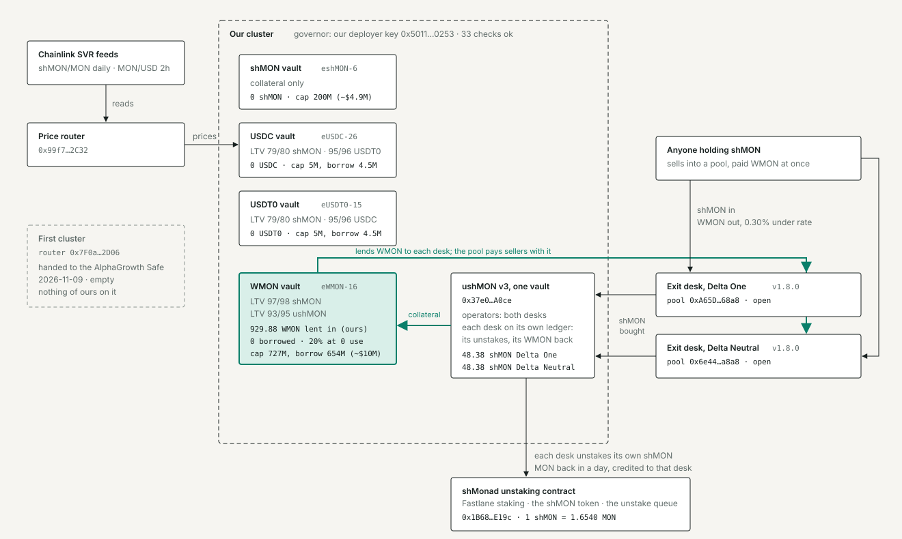

# 6. The lenders: our Euler cluster on Monad, and Neverland

Two Euler clusters on Monad. The live one lends WMON to the two exit desks against their ushMON vaults; the first one
was handed to AlphaGrowth and holds nothing.

- **Cluster**: a set of Euler lending vaults that share one price router.
- **Green**: the WMON loan. The vault lends at 93% of the ushMON's value and liquidates at 95%.
- **ushMON v4**: one vault for both desks. Each desk's unstakes and the WMON they bring back sit on that desk's own
  ledger. Only the desks get shares.
- **Caps**: 727M WMON supply with 654M borrow (about $10M), 5M USDC, 5M USDT0 (set 2026-11-17). LTVs read as
  borrow/liquidation percent.

## The Euler cluster

Files: [`sources/ag-euler/contracts/shmon-cluster-monad/deploy.sh`](sources/ag-euler/contracts/shmon-cluster-monad/deploy.sh)
and [`deployed-143.env`](sources/ag-euler/contracts/shmon-cluster-monad/deployed-143.env) (copied from the local ag-euler working tree on 2026-11-18: its last commit is `6ecd9ad`, and the cap, desk and retirement edits since are uncommitted there; the GitHub remote is behind). Built with the Euler Vault Kit factory `0xba4D…3f1E`, the Euler router factory `0xdDA3…A902`
and the Ethereum Vault Connector `0x7a9324E8f270413fa2E458f5831226d99C7477CD` (`deploy.sh:29-31`). Deployed
2026-11-09 as the second cluster, after the first was handed to the AlphaGrowth Safe and rejected
(`alphastructures/docs/shmon-exit-desk-plan.md:186-193`). The deployer key `0x501107fe590c8F9b81c00b81867fD19e0d9c0253`
is governor of every vault and the router (`deploy.sh:8-9`, confirmed in `evidence/live-reads.md`); `deploy.sh handover`
would move governance to the Safe `0x4f894Bfc9481110278C356adE1473eBe2127Fd3C`, which also receives the fees.

| Vault | Address | Lends? | Caps (supply / borrow) | Rate curve | Lends against |
|---|---|---|---|---|---|
| shMON (eshMON-6) | [0xD81D3E243760eD23Ac3DEf2b08d4989bA2790Dfe](https://monadscan.com/address/0xD81D3E243760eD23Ac3DEf2b08d4989bA2790Dfe) | no (borrow cap 1) | 200M shMON (about $4.9M) | | |
| USDC (eUSDC-26) | [0x5aB09A3EDbb0937Db454f54e6CF04Dd982c40948](https://monadscan.com/address/0x5aB09A3EDbb0937Db454f54e6CF04Dd982c40948) | yes | 5M / 4.5M | `0xe743…97c6` kinked: 8.5% at 80% use, 9.6% at 90% (`ag-euler/safe-payloads/monad-shmon-usdc-caps-rate.json:7`) | shMON 79/80, WMON shares 79/80, USDT0 shares 95/96 |
| WMON (eWMON-16) | [0xE4522663752AC47516e39aD11d3780a116850eaf](https://monadscan.com/address/0xE4522663752AC47516e39aD11d3780a116850eaf) | yes | 727M / 654M (about $10M) | `0xa359…Ba8a`: 20% at 0, 30% at the 90% kink, 50% at 100% | shMON 97/98, **ushMON v4 93/95**, USDC shares 79/80 |
| USDT0 (eUSDT0-15) | [0xD6645190976d456907c9807d08E4E4E220c96a3E](https://monadscan.com/address/0xD6645190976d456907c9807d08E4E4E220c96a3E) | yes | 5M / 4.5M | same as USDC | USDC shares 95/96 |

Common settings: interest fee 10%, max liquidation discount 15%, liquidation cool-off 1 second, hooks off, fee receiver
the Safe (`deploy.sh:63,110-116`). LTV pairs are borrow/liquidation in percent (`deploy.sh:55-60`).

**Oracles.** One Euler router, `0x99f7105CAC565Ac830cf2d66527FBb06dD322C32`, with Chainlink SVR adapters built from
euler-xyz/euler-price-oracle `63f20a4`, set 2026-11-12 ("our oracles will be chainlink SVR", `deploy.sh:37-43`):
shMON/USD as a cross of the shMON/MON SVR rate and WMON/USD (`0x2B43…eAB6`), WMON/USD (`0xe6a6…fB9d`), USDC/USD
(`0x7459…8284`), USDT0/USD (`0xBD48…519F`). Each ushMON is a "resolved vault" on the router, priced through its
`convertToAssets` into shMON (`deploy.sh:192`).

**State on 2026-11-19.** The WMON vault holds 929.88 WMON lent by the deployer key, none of it borrowed, so it charges
20% at zero use. The shMON, USDC and USDT0 vaults hold nothing. ushMON v4 `0xa753…8C5e` holds 48.38 shMON for each desk,
and both desks run v1.10.0 with their pools open. The deployer key is still governor; the cluster's 33 configuration
checks read ok on 2026-11-18, and caps were set on 2026-11-17.

## Neverland

Neverland is an Aave v3 fork on Monad, pool `0x80F00661b13CC5F6ccd3885bE7b4C9c67545D585`, the vaults' first lender
(`alphastructures/deploy/configs/production/shmon-neverland-usdc-hl.json:54-83`). The vaults supply shMON (aToken
`0xC64d73Bb8748C6fA7487ace2D0d945B6fBb2EcDe`) and borrow USDC (aToken `0x3864…7508`) or USDT0 (aToken `0x39F9…6bDf`).
The config records the collateral's own yield at 12.26% a year (`collateralYieldAprBps`).

The bot reads a lender's room before its kink, "free cash, capped so its utilization stays at or under the kink"
(`services/rebalancingBot/src/lenders.ts:128-166`): for Neverland, aToken supply × optimal usage ratio − variable debt.
Read on 2026-11-19 at block 123,490,679 (`evidence/live-reads.md`):

| Reserve | Supplied | Borrowed | Utilization | Kink | Room before kink | Borrow rate |
|---|---|---|---|---|---|---|
| USDC | 2,786,215 | 2,389,314 | 85.8% | 90% | **118,279 USDC** | 5.72% |
| USDT0 | 2,042,831 | 1,819,275 | 89.1% | 90% | **19,273 USDT0** | 5.94% |

Neverland holds 29.1M shMON (the shMON aToken's supply), about 15% of the 199.0M shMON outstanding (329.2M MON staked at
1.6544 MON per shMON). On 2026-11-09 the USDC reserve stood at 87.5% used (`docs/Alpha_Structures_Rebalancing_Policy.md:125`),
which is what makes the stable desk's USDC to USDT0 debt move and the second lender necessary.
