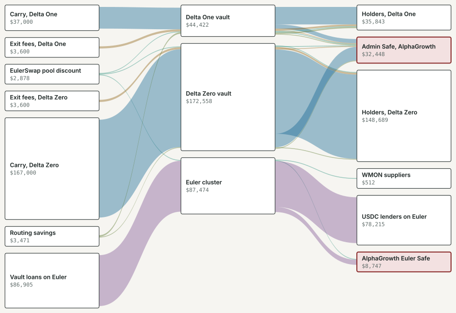

# 12. Revenue flows

What makes money, how much, and where it goes. The admin Safe will be handed over to AlphaGrowth, so its performance
fees and the Euler interest fee count as AlphaGrowth's below.[^fees]

## What TVL means here

TVL is the shMON depositors put into the two vaults, in dollars. The bot levers it to the 43% target, so $2M of TVL
becomes:

| Piece | At $2M TVL | Formula |
|---|---|---|
| shMON collateral | about $3.5M | TVL ÷ (1 − 0.43) |
| Stablecoin borrowed | about $1.5M | TVL × 0.43 ÷ (1 − 0.43) |

The depositors still own $2M: $3.5M of shMON less the $1.5M loan. WMON lending is not part of TVL. It grows with the
EulerSwap pools' volume.

## What makes money

| Source | How | Who gets it |
|---|---|---|
| Performance fee | 10% of every rise in the share price over its last posted price. Delta One counts in shMON, Delta Neutral in dollars. Paid as new shares. | the admin Safe |
| Exit fee | 0.30% kept from every withdrawal | the holders who stay |
| EulerSwap pools | buy shMON 0.30% under shMonad's rate, less about a day of WMON interest | the desk, then its vault |
| shMON arbitrage | the keeper buys cheap shMON elsewhere and sells it into our pools | the desk, then its vault |
| Digester | the keeper's gain on each fill, plus the 0.01% pool fee on our orders | the vault |
| WMON lending | 90% of the interest the desks pay | WMON lenders |
| Euler interest fee | 10% of all interest paid in the cluster | the AlphaGrowth Euler Safe |
| Routing savings | leavers' shMON sells on Curve or through the desk instead of shMonad's instant exit, saving about 0.45% a sale | the vault, as a fee it avoids |
| Stable desk | moves debt to the cheaper stablecoin | the vault, as lower borrowing cost |

The exit bid pools would also buy shMON at a 0.30% discount, but they hold no bids today.

The exit fee, pool margin, arbitrage and digester gains all raise the share price, and AlphaGrowth takes 10% of every
rise. Because it also charges the climb back after a dip, that comes to about 21% of what holders net on Delta One and
14% on Delta Neutral.

## Where it goes at $2M TVL

**Calculator:** [`calculator/revenue-calculator.html`](calculator/revenue-calculator.html). Download it and open it in a
browser to change any input and see every flow update. Its defaults give the table below.

| Receiver | From | $ a year |
|---|---|---|
| Admin Safe, AlphaGrowth | performance fees: 8,579 from Delta One, 23,869 from Delta Neutral | 32,448 |
| AlphaGrowth Euler Safe | the Euler interest fee on WMON and USDC loans | 8,747 |
| Holders, both vaults | carry, exit fees, pool margin and routing savings, after the performance fee: 35,843 Delta One, 148,689 Delta Neutral | 184,532 |
| USDC lenders on Euler | the vaults' loan interest, after the Euler fee | 78,215 |
| WMON lenders | the desks' WMON interest, after the Euler fee | 512 |

Inputs:
- $1M in each vault, with 10% of TVL withdrawn a month.
- A 43% loan, 60% of it on Euler at 9.6%.
- 150,000 MON of pool buys every 20 hours, split evenly between the desks.
- 170,000 MON of WMON lending, a 20-hour unstake, and MON at $0.0146.

## Net carry

Per $1 deposited at the 43% target, Delta One holds $1.49 of shMON, a $0.64 loan and a $0.49 short. Delta Neutral holds
$1.15 of shMON, a $0.49 loan and a $1.15 short.

| Per $1 deposited | Delta One | Delta Neutral | Rate used |
|---|---|---|---|
| shMON staking | +16.4% | +12.7% | 11.01% a year |
| MON funding paid to shorts | +3.5% | +8.1% | 7.03% a year, Hyperliquid's 30-day average |
| Stablecoin interest | −5.2% | −4.0% | 8.06%: 60% on Euler at 9.6%, 40% on Neverland at 5.74% |
| Total in dollars | 14.7% | 16.7% | |
| Net carry used above | **3.7%** | **16.7%** | |

Delta One's share price is counted in shMON, so its holders' own 11.0% staking yield is taken out of its net carry.
Neverland pays nothing on supplied shMON, and trading fees and the cost of building the book are left out.

The 60% Euler share assumes $1M of USDC lending arrives on the Euler cluster. With only Neverland, the loan costs 5.74%,
and net carry is 5.2% on Delta One and 17.9% on Delta Neutral.

## Formulas

- **Pool gross** = MON bought per 20 hours × 438 cycles a year × 0.30% × MON price.
- **WMON interest** = MON bought × 0.997 × 438 × ln(1 + borrow rate) × unstake hours ÷ 8,760 × MON price.
- **Pool margin** = pool gross − WMON interest.
- **Exit fees** = TVL × share withdrawn a month × 12 × 0.30%.
- **Routing savings** = TVL × share withdrawn a month × 12 × shMON sold per $1 withdrawn × 0.45%. A vault sells $0.49
  of shMON per $1 withdrawn on Delta One and $0.15 on Delta Neutral.
- **Vault gain** = carry + exit fees + pool margin + routing savings.
- **Performance fee** = 10% × (vault gain + carry × (churn − 1)). Churn is 2.12 on Delta One and 1.40 on Delta Neutral.
  It measures how much more fee comes from charging every rise, including the climb back after a dip, in a replay of
  Hyperliquid's hourly MON funding from 2025-10-08 to 2026-11-18.
- **Euler loan interest** = TVL × 0.43 ÷ 0.57 × Euler share × Euler rate. Lenders get 90%, and AlphaGrowth 10%.

## The live revenue page

`https://admin.structures.gg` shows these flows from live data, behind a password. It runs on the production server and
refreshes every minute. Nothing on it can be edited.

| Part | Where the number comes from |
|---|---|
| Fees and settings | the contracts: performance fee, exit fee, pool discount and loan limit |
| Book and rates | each bot's latest reading: equity, collateral, debt, short, loan, rates and prices |
| Euler cluster | the USDC, USDT0 and WMON vaults: supplied, borrowed, rates, caps, limits and fees earned |
| Holders, last 30 days | each hourly share price step times the shares outstanding |
| Performance fee, last 30 days | every fee charged on each vault |
| Exit desks, last 30 days | pool buys, keeper arbitrage, exit fees and routing savings |
| Euler interest | today's loans times today's rate, split 90% to lenders and 10% to AlphaGrowth |

Yearly figures are the last 30 days × 365 ÷ 30.

[^fees]: Fees and receivers read on chain, 2026-11-18 and 2026-11-19. Code: `StrategyControllerSettings.sol`, `WithdrawalHandler.sol`, `MonadRouter.sol`.
